<p align="center">
  
</p>

# My Morning News

My Morning News is a research assistant you run yourself. You describe something you want to stay on top of. It
interviews you until it knows what to look for and what to skip. Then it researches on your schedule, ranks what it
finds, backs every claim with a quote from the source, and sends you a briefing you can read, listen to, or get by
email. Your feedback teaches it what you care about, and it keeps score on its own predictions.

> **Status: alpha (`0.1.0-alpha`).** The self-hosted product is feature complete for its first release and covered by
> automated tests. The hosted service at `app.mymorningnews.ai` and the iOS and Android store listings open once the
> owner's launch steps are done ([`OWNER_ACTIONS.md`](OWNER_ACTIONS.md)). Progress is tracked in
> [`MY_MORNING_NEWS_PLAN.md`](MY_MORNING_NEWS_PLAN.md), section 32.

## What it does

- Refines a topic with you. Start from a sentence ("AI developer tools", "heat pump rebates in Colorado"). The
  wizard proposes dimensions to weight, asks clarifying questions, drafts a brief with includes, excludes, and
  preferred sources, and suggests feeds. You edit everything.
- Researches on a schedule. Every n minutes, hours, or days, chosen days of the week or month, once, or cron, in
  your time zone. A staged pipeline plans queries, searches, fetches pages, extracts and scores findings, removes
  duplicates, writes predictions and suggestions, and composes a briefing. You can watch a run live and retry it from
  any stage.
- Backs up every result. Each finding has a 0 to 100 relevance score built from model judgment, your past
  feedback, novelty, source reputation, and recency, and each claim links to a verbatim quote that was checked against
  the page it came from.
- Looks ahead. Runs make predictions with a confidence and a horizon date. When a prediction comes due you grade
  it (or accept a proposed grade), and accuracy and calibration are charted over time. Suggestions point at what to
  dig into next.
- Delivers it your way. Briefings follow Markdown templates you can edit. Editions combine several topics on
  their own schedule. Output is Markdown and HTML, audio from a local Kokoro voice (or any OpenAI-compatible speech
  service), a private podcast feed, an email after every run with rating links (each opens a short page where you
  confirm the rating, so mail scanners that open links cannot rate for you), and push notifications to the mobile app.
- Learns from you. Rate anything and say why, on the web, in email, in the app, or through MCP. The system turns
  feedback into preferences you approve, and the Insights pages chart relevance, accuracy, feedback, cost, and usage.
- Uses the model you choose. Model access goes through [PolyPrompt](https://github.com/jchristn/PolyPrompt):
  Anthropic (the default), OpenAI, OpenAI-compatible servers, Ollama, Ollama Cloud, Gemini, and xAI, plus the agent
  CLIs Claude Code, Codex, Gemini CLI, and Mux running in the server, assignable per task. Topics can opt in to
  agentic search, where the model searches, reads, and calls the MCP tools you allow.
- Runs for one person or many. Tenants, users, roles and permissions, access keys, signed requests, audit, request
  history, plans with usage caps, promotional codes, and an optional public sign-up for a hosted service.

## Use cases

- Stay current on a field without reading everything yourself.
- Get one morning briefing across several interests, to read over coffee or hear on the drive in.
- Track forward-looking calls (prices, launches, policy changes) and see which ones came true.
- Give a team a shared research feed with per-person preferences, or run it as a service for others.

## Screenshots

These come from the demo account that `docker/factory/reset.sh --demo` creates, plus a few weeks of extra runs and
model calls so the charts have data. The topics, sources, and products in them are made up.

<details>
<summary>Today and the briefing reader</summary>

Today shows the latest Morning News edition with its audio player above the text.

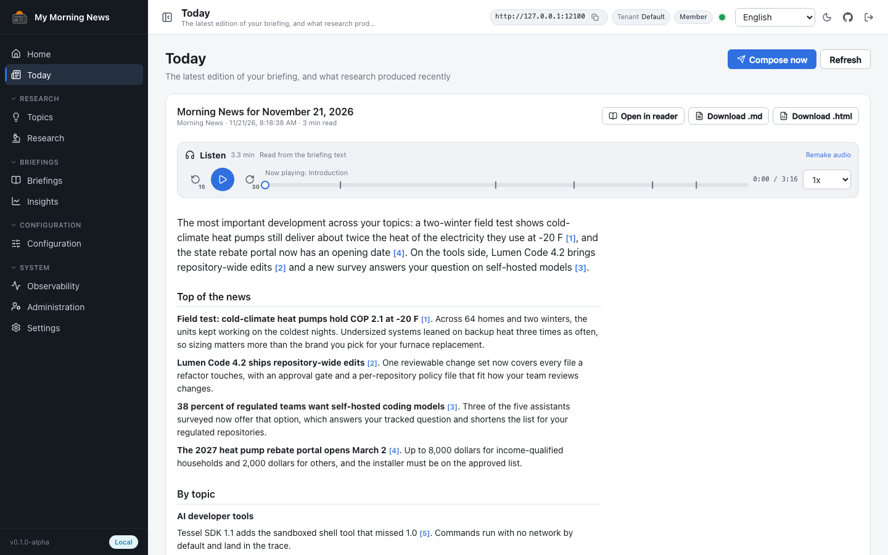

The reader adds audio chapters, a section outline, numbered citations, and a relevance rating for each section.

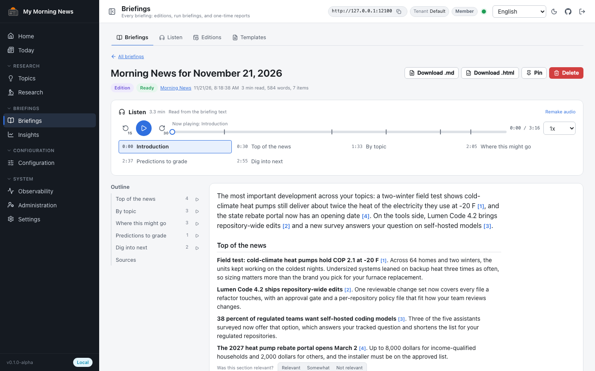

</details>

<details>
<summary>Topics and the refinement wizard</summary>

Topics lists each topic with its status, last run, and last refinement.

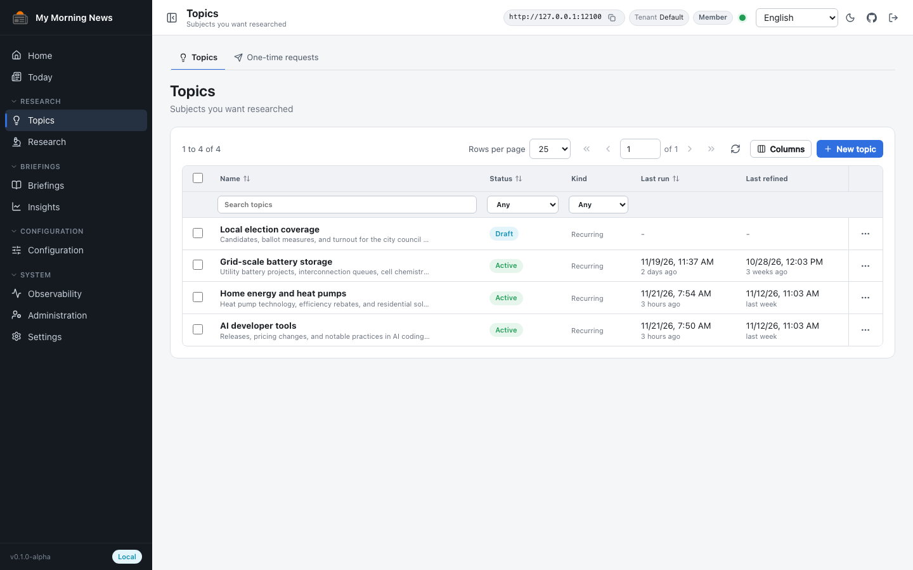

The wizard's Dimensions step: weigh, lock, edit, or exclude each angle the research covers, with terms to include and
exclude.

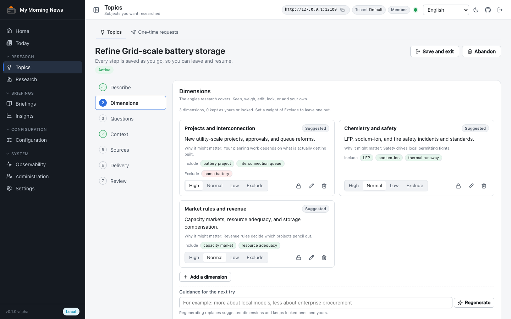

A topic's Runs tab charts the cost of its last 20 runs above the run table.

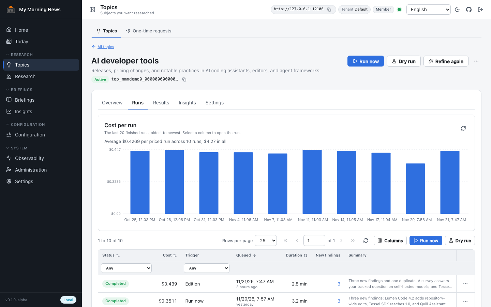

</details>

<details>
<summary>Research runs and cost</summary>

Research, Runs: median and p95 duration of each pipeline stage, and model cost by stage, over one time range.

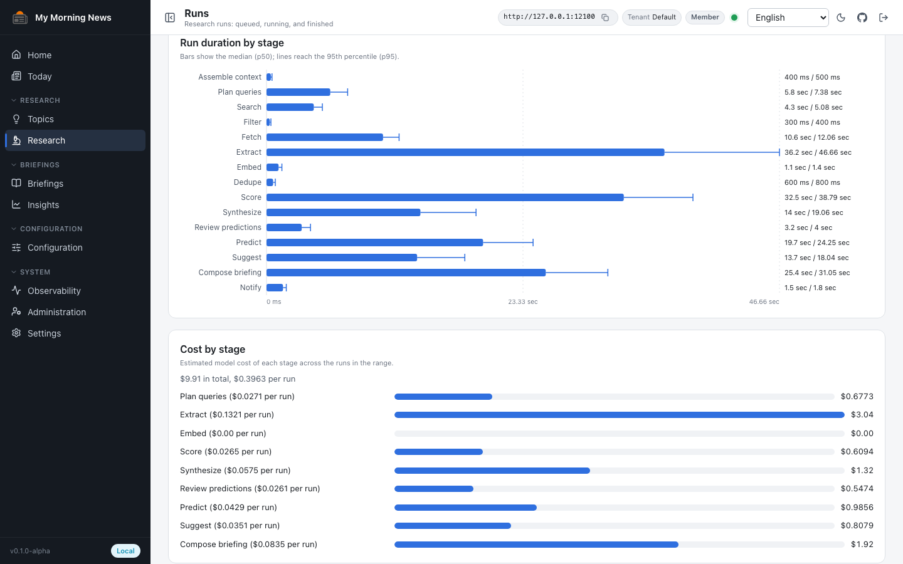

A run's detail opens with its cost, tokens, model calls, and cost per new finding, and the Costs tab shows where the
money went, stage by stage.

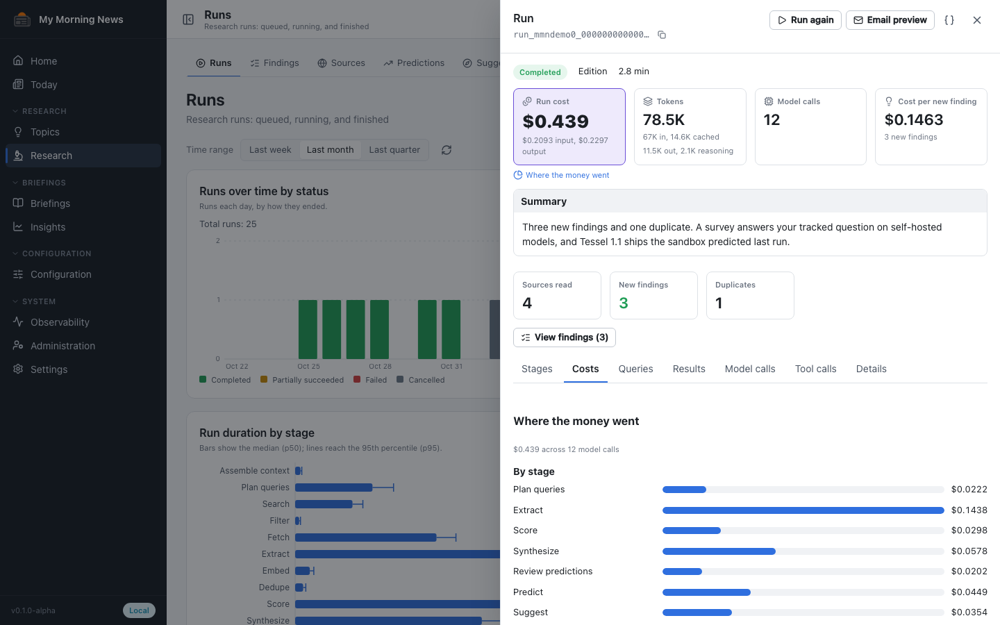

</details>

<details>
<summary>Findings and evidence</summary>

A finding shows how its relevance score breaks down and the verified quotes behind it, each linked to its source.

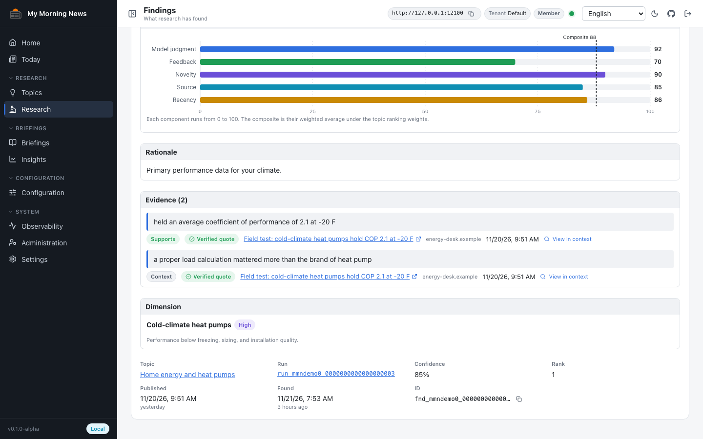

</details>

<details>
<summary>Home and Insights</summary>

Home sums up the last 30 days: runs, findings shown, relevance precision, feedback, and model cost, with runs per day
by status.

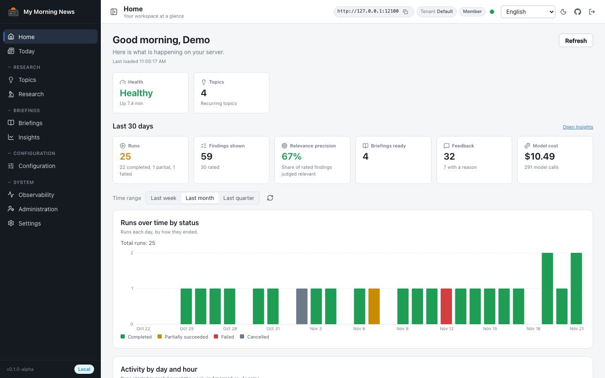

Insights, Accuracy grades predictions: accuracy rate, Brier score, and a calibration curve of stated confidence against
what came true.

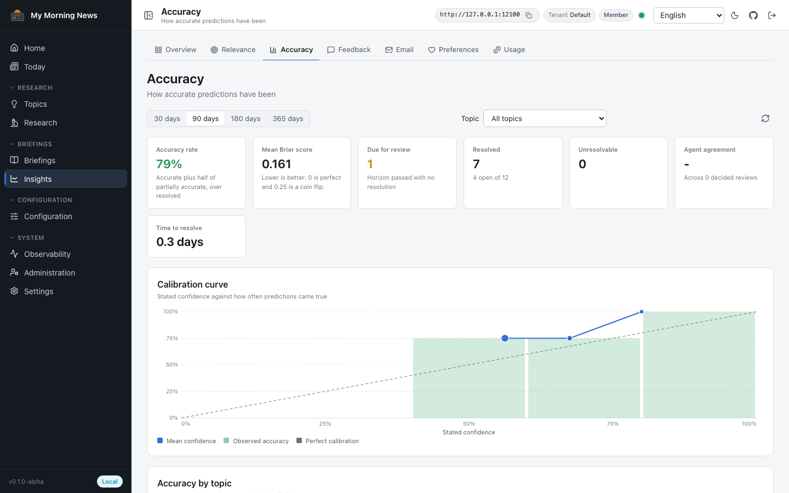

Insights, Usage shows cost, calls, tokens, failures, and time to first token, with cost over time and by user.

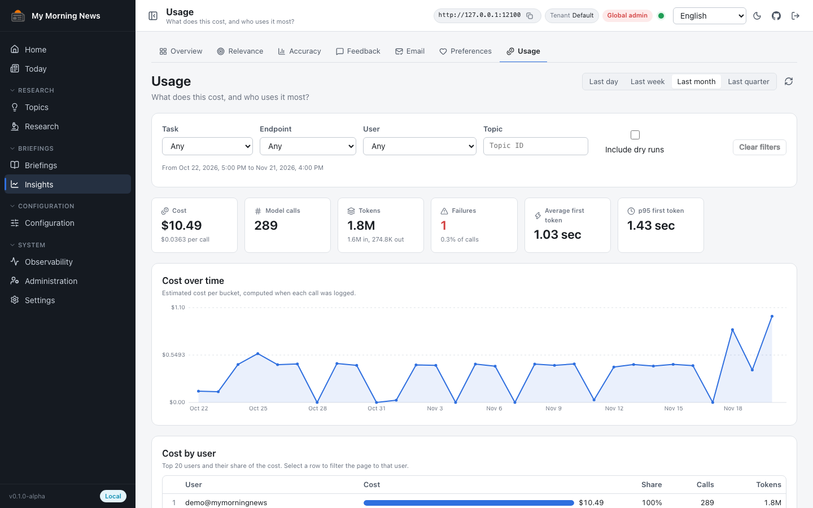

</details>

<details>
<summary>Setup and configuration</summary>

The Setup page on a new workspace: connect a chat model with an agent CLI and your subscription, an API key, or your
own model server.

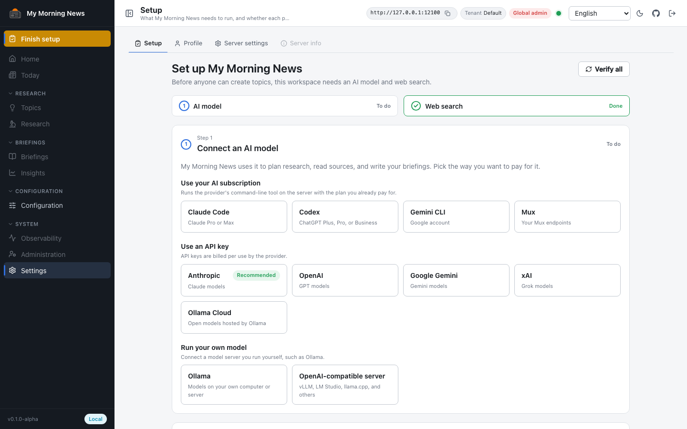

Configuration, Models: the endpoint and reasoning effort assigned to each pipeline task.

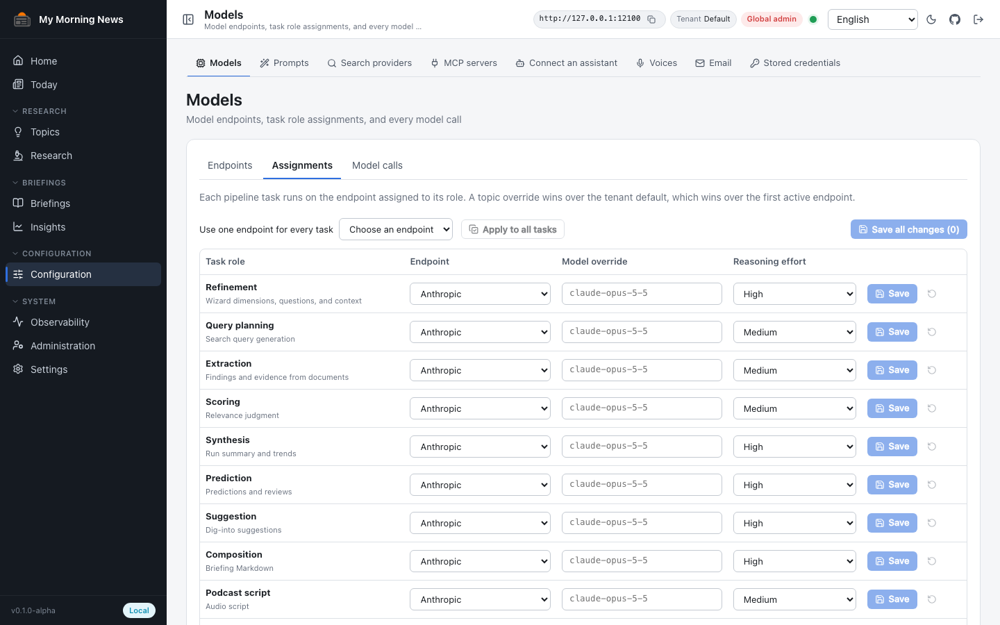

</details>

## Architecture

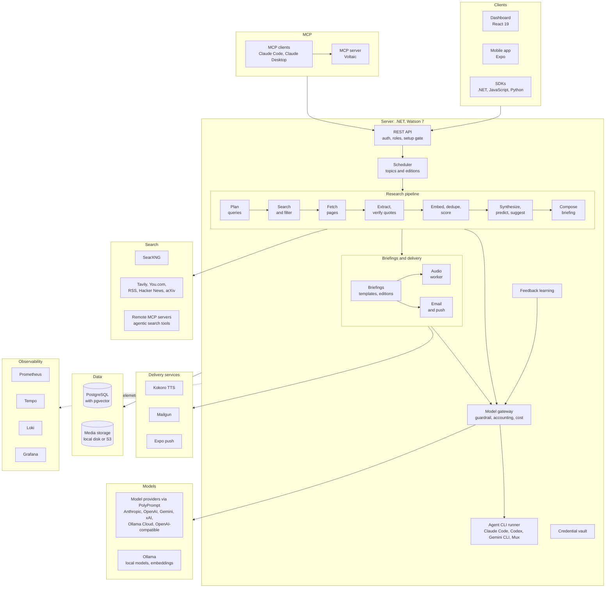

| Component | What it is | Port |
|-----------|------------|------|
| `server` | REST API, research pipeline, scheduler, briefing, audio, email, and push workers | 12100 |
| `dashboard` | React 19 dashboard served by nginx | 12101 |
| `postgres` | PostgreSQL 17 with pgvector | 12102 |
| `searxng` | Private metasearch, no API key needed | 12103 |
| `tts` | Kokoro text-to-speech | 12104 |
| `mcp` | MCP server, Streamable HTTP (profile `mcp`) | 12105 |
| `grafana`, `prometheus`, `tempo`, `loki` | Observability | 12110 to 12115 |
| `ollama` | Local models and embeddings (profile `ollama`) | 12120 |

Every port is bound to `127.0.0.1`. Grafana's local sign-in is `admin` / `admin`.

## Quick start (Docker)

```bash
git clone https://github.com/jchristn/MyMorningNews.git
cd MyMorningNews/docker
cp .env.example .env        # optional: put your Anthropic key in MYMORNINGNEWS_ANTHROPIC_API_KEY
docker compose pull && docker compose up -d
```

Every service runs a published image from Docker Hub (`jchristn77/mymorningnews-<type>:latest`); nothing is built
on your machine.

Open the dashboard at http://127.0.0.1:12101 and sign in. Change these credentials before exposing the stack.

| Field | Value |
|-------|-------|
| Email | `admin@mymorningnews` |
| Password | `password` |
| Tenant | `default` (or leave it blank) |

After you sign in, the dashboard shows the Setup page until the workspace has what it needs: a chat model that
answered a live test prompt, and a web search provider that answered a test query (the bundled SearXNG passes on its
own). You can leave at any time with Skip for now: it lists what is still missing and what will not work without it,
opens the rest of the dashboard, and keeps a Finish setup link at the top of the menu. Once both work, Setup is a
status page under Settings. It also shows the optional items (embeddings, email, and speech, with a Test speech
button). The Setup page lets you connect the chat model in one of three ways:

- Your AI subscription, through an agent CLI in the server: Claude Code with a token from `claude setup-token`, Codex
  with the `auth.json` that `codex login` writes, Gemini CLI with the sign-in file from your Google sign-in
  (`~/.gemini/oauth_creds.json`), or Mux.
- An API key for Anthropic, OpenAI, Google Gemini, xAI, or Ollama Cloud.
- Your own model server: Ollama or any OpenAI-compatible server.

Keys, tokens, and sign-in files are stored encrypted, and the page tests each choice with a live prompt right away.
If you set `MYMORNINGNEWS_ANTHROPIC_API_KEY` in `.env` before the first start, the Setup page checks that key instead.
People who are not administrators see a notice until an administrator finishes. Then create a topic from Topics, New
topic.

Sign in through the API:

```bash
curl -s -X POST http://127.0.0.1:12100/v1.0/token -H 'x-email: admin@mymorningnews' -H 'x-password: password'
```

Send the returned token as `Authorization: Bearer <token>`. The OpenAPI document is at
http://127.0.0.1:12100/openapi.json and Swagger UI at `/swagger`. [`REST_API.md`](REST_API.md) describes every route,
and [`assets/postman/`](assets/postman/) has a Postman collection.

Helpers: `docker/update.sh` (or `.bat`) pulls the latest images and restarts the stack without touching data
(`docker compose pull && docker compose down && docker compose up -d && docker ps -a`).
`docker/factory/reset.sh` (or `.bat`) deletes all data and starts fresh; add `--demo` for a demo account
(`demo@mymorningnews` / `password`) with topics, finished runs, findings, evidence, predictions, briefings, and
feedback, created without model calls or an API key.

## Models and search

The default chat model is Anthropic `claude-opus-5-5`. Any task (refinement, synthesis, scoring, composition, podcast
script, feedback analysis) can be assigned to another endpoint under Configuration, Models. Embeddings default to
Ollama `all-minilm` when Ollama is available (`docker compose --profile ollama up -d`).

A chat endpoint can also be an agent CLI that runs inside the server container: Claude Code, Codex, Gemini CLI, or
Mux, signed in with your subscription or an API key. Each CLI endpoint gets its own home folder under
`Models.CliHomeDirectory` (the `clihome` volume in Docker) and runs in the CLI's most restricted permission mode in an
empty working folder, so it cannot read or change anything else on the server. The sign-in file is written there
only when the stored copy changes, so tokens the CLI refreshes are kept. CLI endpoints make no tool calls, so a topic
with agentic search falls back to the fixed query plan when its model is a CLI. They answer structured requests in
JSON and do not provide embeddings. Set `MYMORNINGNEWS_MODELS_ALLOW_AGENT_CLIS=false` to turn them off; the hosted
overlay does.

A model served by Ollama or another OpenAI-compatible server can call tools but
cannot search the web by itself; only OpenAI and xAI endpoints offer hosted web search. The bundled
SearXNG works without a key, and Tavily and You.com work with an API key (Configuration, Search providers). Agentic
search needs a model that supports tool calls.

Each model call records who it is attributed to, the topic and run, input, cached, cache-write, output, and
reasoning tokens, time to first token, tool calls, retries, and estimated cost. Insights, Usage shows the totals, as
does `GET /v1.0/api/usage/report`.

Every run and every stage of a run shows its estimated cost in US dollars, from the prices set on each model endpoint,
with calls that have no price counted separately. `GET /v1.0/api/runs/{id}/costs` breaks a run's cost down by stage,
model, and task (see [Run and stage cost](REST_API.md#run-and-stage-cost)).

A scope guardrail is prepended to every model call, and every default prompt repeats it: models only research and
summarize your topics, treat fetched pages as data rather than instructions, and decline unrelated
requests.

API keys for models, search, email, speech, and MCP servers are stored once, encrypted, in
the credential vault, and referenced by what uses them. Reads return only the last four characters; the user who stored a value and tenant
administrators can reveal it through an audited, rate-limited action.

## Email

The stack starts with the `File` email provider, which writes each email to the `emailout` volume
(`docker compose exec server ls /data/email`). To send for real, verify a Mailgun sending domain and set
`MYMORNINGNEWS_EMAIL_PROVIDER=Mailgun`, `MYMORNINGNEWS_MAILGUN_DOMAIN`, and `MYMORNINGNEWS_MAILGUN_API_KEY` in
`docker/.env`. The From domain must match the sending domain for DMARC. The Email section of Settings has a Send test button.
For email links and podcast feeds that open on your phone, set `MYMORNINGNEWS_PUBLIC_BASE_URL` and
`MYMORNINGNEWS_APP_BASE_URL` to addresses the phone can reach.

## Mobile apps

The Expo app in [`mobile/`](mobile/README.md) runs on iPhone, iPad, and Android phones and tablets: today's briefings
with audio that resumes across devices, findings and evidence, predictions, suggestions, feedback, topics, editions,
one-time requests, insights, and account settings, in 12 languages. Point it at your server's address. Store builds
use EAS; the submission details are in [`APP_STORE_SUBMISSION.md`](APP_STORE_SUBMISSION.md).

## MCP server

The MCP server lets Claude Code, Claude Desktop, and other MCP clients list your topics, read today's briefing, check
the evidence behind a finding, and record feedback. It acts only with your own credentials.

```bash
cd docker && docker compose --profile mcp pull && docker compose --profile mcp up -d
claude mcp add --transport http mymorningnews http://127.0.0.1:12105/mcp --header "Authorization: Bearer <session token>"
```

`docker/update.sh` also updates every profile you name in `COMPOSE_PROFILES`, for example
`COMPOSE_PROFILES=mcp ./update.sh`.

For a long-lived connection, create an access key under Credentials. Stdio mode, every tool, the resources, and the
prompts are in [`MCP_API.md`](MCP_API.md). Separately, topics can call tools on remote MCP servers you register under
Configuration, MCP servers (Streamable HTTP).

## SDKs

C#, JavaScript, and Python SDKs live in [`sdk/`](sdk/README.md). Each covers the whole API, supports signed requests
and live run events, raises typed errors for plan limits, and ships a harness you can run against your own server.

## Hosting a service

The same code runs a public service with sign-up, email verification, plans with monthly cost caps, account deletion
and export, a platform model key that tenants cannot read, and private-network blocking. Turn it on with the
`docker/hosted` overlay; [`docs/HOSTING.md`](docs/HOSTING.md) walks through it.

## Building from source

```bash
dotnet build src/MyMorningNews.sln
cd dashboard && npm ci && npm run lint && npm test && npm run build
```

Tests need PostgreSQL. With the Docker stack running:

```bash
MYMORNINGNEWS_TEST_DB="Host=127.0.0.1;Port=12102;Username=postgres;Password=password" \
  dotnet run --project src/Test.Automated -f net10.0 -- --provider postgresql
```

The same suites run under xUnit (`dotnet test src/Test.Xunit3`). The mobile app's checks are `cd mobile && npm run
verify`.

### Docker images

`docker/compose.yaml` uses only published images. To publish new ones, run `./build-all.sh <tag>` (or `build-all.bat`)
from the repository root: it builds every image on the Docker cloud builder for `linux/amd64` and `linux/arm64`,
pushes each as `jchristn77/mymorningnews-<type>:latest` and `:<tag>`, and pulls them back. One image at a time:
`./build-server.sh <tag>`, and likewise `build-dashboard`, `build-mcp`, `build-searxng`, `build-tts`, `build-ollama`,
`build-prometheus`, `build-tempo`, `build-loki`, and `build-grafana`. Then `docker/update.sh` runs them.

## Languages

The dashboard and the mobile app are translated into English, Spanish, Portuguese, French, Italian, German, Chinese,
Arabic (right to left), Russian, Malay, Hindi, and Japanese. The translations other than English are machine-made and
waiting for native review ([`docs/I18N.md`](docs/I18N.md)).

## Database support

PostgreSQL with pgvector is the only supported database. The data layer keeps a provider abstraction
(`DatabaseDriverBase` and `DatabaseDriverFactory`), so another provider could be added without changing services.

## AOT support

Not supported. The server depends on libraries that are not AOT-compatible (CrawlSharp with Playwright, TextChunker)
and ships as a Linux container.

## Benchmarks

A black-box benchmark suite measures research quality (ranking, suppression, de-duplication, evidence verification),
the full run-to-email-to-audio flow, resilience to failing dependencies, and API and run throughput, against an
isolated stack with stubbed model, search, and speech services, so it makes no paid calls. A deterministic subset runs
in CI as the "Benchmark gate". See [`benchmarks/README.md`](benchmarks/README.md) to run it,
[`benchmarks/RESULTS.md`](benchmarks/RESULTS.md) for the numbers, and [`BENCHMARKING.md`](BENCHMARKING.md) for the plan.

## License

MIT. See [LICENSE.md](LICENSE.md).

(c) 2026 Lattice AI LLC
